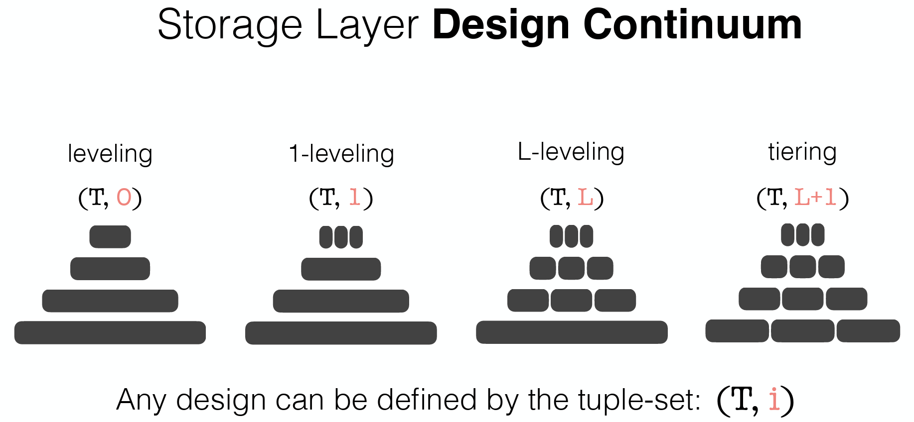

Modern LSM-based storage engines are simultaneously the most widely deployed and the most poorly configured class of data systems in existence. RocksDB alone exposes several hundred tuning options, and the space of valid engine designs — spanning compaction policies, memory allocation, filter settings, block sizes, and data layout strategies — runs into the **trillions of unique configurations** <a class="rp-cite" href="#pub-2">[2]</a>. Yet the vast majority of deployments run on defaults tuned for someone else's workload. The result is predictable: production systems routinely operate at a fraction of their attainable performance, and the gap widens every time the workload shifts.

This is the least mature and most ambitious of our research themes — and the one that defines our agenda going forward. Building on a decade of work that mapped the LSM design space, we are now building a *self-designing* LSM engine: one that observes its own workload, identifies the design best suited to it, and transitions to that design online, without taking the system down or interrupting service.

<blockquote class="rp-pull">
Can a storage engine learn the optimal design for its workload — and transition to it on the fly, without performance interruption?
</blockquote>

<figure>
  
  <figcaption>LSM designs do not live at discrete points — they span a continuum of compaction triggers, data layouts, granularities, and file-picking policies. A self-designing engine navigates this continuum automatically, moving toward the design that best matches the current workload.</figcaption>
</figure>

## The Foundation: Mapping the Design Space

A system cannot redesign itself over a space that has not been characterized. The foundation of this agenda is our work formalizing the LSM design space — in particular, the space of *compactions*, the background reorganization machinery that dominates LSM performance.

Our PVLDB study <a class="rp-cite" href="#pub-1">[1]</a> deconstructs LSM compaction into four orthogonal primitives — the *trigger* (when to compact), the *data layout* (how runs are organized per level), the *granularity* (how much data moves at once), and the *file-picking policy* (which data moves) — and shows that combinations of these primitives generate over **10,000 distinct compaction strategies**, of which production systems use only a handful. The accompanying experimental analysis benchmarks representative strategies head-to-head, quantifying how the choice of compaction strategy shifts write amplification, space amplification, point-lookup latency, range-scan cost, and tail behavior as the workload's composition and distribution vary. Two consistent lessons emerge: no single compaction strategy dominates across workloads, and the performance gap between the best and the default choice is large enough to matter in production.

Our SIGMOD tutorial <a class="rp-cite" href="#pub-2">[2]</a> extends this map beyond compactions to the full LSM design space — memory allocation between buffers and filters, tiering–leveling hybrids, and the analytical cost models that connect design decisions to workload characteristics. And **Compactionary** <a class="rp-cite" href="#pub-3">[3]</a>, our SIGMOD demonstration, makes the design space tangible: an interactive dictionary that lets practitioners explore compaction designs, compare their behavior under different workloads, and understand *why* a given strategy wins or loses. Together, these efforts turn LSM design from folklore into a structured space that can be searched — by a human, or by the engine itself.

## Why the Status Quo Fails

**Hand-tuning does not scale.** The traditional answer to the tuning problem is the database administrator, converging on a good-enough configuration through experience and experimentation. But no human can systematically explore a space of thousands of compaction strategies interacting with hundreds of other knobs; the best-known configurations are products of intuition and convention, not optimization.

**Configurations are static; workloads are not.** A design tuned for an ingestion-heavy write burst becomes a liability during the read-heavy serving phase that follows. Few systems re-tune when the workload shifts, because re-tuning is expensive and disruptive — and because compaction remains a black box that makes even *reasoning* about the consequences of a design change difficult <a class="rp-cite" href="#pub-1">[1]</a>.

**Offline ML tuners stop short.** Learning-based tuning systems in the literature typically depend on pre-collected performance logs or benchmark-specific training data, and — more fundamentally — they end at a *recommendation*. None of them addresses the systems problem at the heart of self-design: how a live engine, holding terabytes of data, physically migrates from one design to another while continuing to serve reads and writes.

## The Vision

Our answer is organized around three research thrusts that together close the loop from observation to redesign.

### 1. Workload and Performance Sensing

A self-designing engine must first know itself. We are instrumenting the storage engine to continuously characterize its workload — the mix, distribution, and temporal drift of inserts, updates, point queries, range scans, and deletes — alongside its own performance profile, at negligible overhead. The sensing layer must distinguish a genuine workload shift from transient noise: reacting to every fluctuation would make the engine thrash between designs, while reacting too slowly forfeits the benefit of adaptivity.

### 2. Learning the Workload-to-Design Mapping

At the core of a self-designing engine sits a learned model of the relationship between workloads and designs, trained on systematic benchmarking of the design space and refined online from the engine's own telemetry. We deliberately treat the choice of learning technique as open — classical models, deep learning, and hybrid analytical–learned approaches all have a role — because the structure of the problem, not fashion, should pick the tool.

A direction we are particularly excited about is using **large language models as configuration reasoners**. LLMs trained on the systems literature, engine documentation, and benchmark reports have already absorbed substantial domain knowledge about how storage engines behave. We envision LLMs serving as few-shot priors: given a description of an application's access patterns and performance goals, proposing a starting design far better than any shipped default, which the engine's own learned models then refine against live feedback. A complementary role is *hypothesis generation* — using LLMs to propose novel compaction strategies expressible in the four-primitive language of the design space <a class="rp-cite" href="#pub-1">[1]</a>, which are then vetted empirically. The engine's search need not be limited to designs humans have already thought to try.

### 3. Online Design Transitions

The thrust that makes this a *systems* problem rather than a pure ML problem: once a better design is identified, the engine must get there from here. A design transition is a physical migration — data laid out under one compaction policy must be reorganized under another — and doing it eagerly would incur exactly the kind of performance cliff that self-design is meant to eliminate. Our approach is to make transitions *incremental and opportunistic*: piggybacking reorganization on the compaction work the engine performs anyway, so that the tree gradually flows toward the new design while normal operation continues. Characterizing the transition cost — and deciding *when* a predicted benefit justifies paying it — is a central open question of the agenda.

## Outlook

The end state we are working toward is a storage engine with no tuning manual: one that ships with knowledge of its own design space, senses what its application needs, and quietly becomes the engine that application would have been hand-built to use. The design-space foundation is published; the sensing, learning, and transition machinery is under active construction — and this agenda will anchor our group's research in the years ahead. If the problem excites you, we are looking for students.

## The Design Space at a Glance

  

    1T+
    unique storage engine configurations in the LSM design space
  

  

    10,000+
    compaction strategies generated by the four design primitives
  

  

    4
    orthogonal primitives that define any LSM compaction: trigger, layout, granularity, file picking
  

  

    1
    default configuration most deployments actually run
  

## Relevant Publications

<ol class="rp-pubs">
  <li id="pub-1">Subhadeep Sarkar, Dimitris Staratzis, Zichen Zhu, Manos Athanassoulis. Constructing and Analyzing the LSM Compaction Design Space. PVLDB 2021.<a href="/assets/fulltext/Constructing_and_Analyzing_the_LSM_Compaction_Design_Space.pdf" target="_blank" rel="noopener" class="pub-icon" role="button" aria-label="PDF"><i class="fa-regular fa-file-pdf"></i></a><a href="/assets/resources/LSM_Compaction_VLDB.pdf" target="_blank" rel="noopener" class="pub-icon" role="button" aria-label="Slides"><i class="fa-solid fa-chalkboard"></i></a><a href="/assets/resources/PVLDB_poster.pdf" target="_blank" rel="noopener" class="pub-icon" role="button" aria-label="Poster"><i class="fa-regular fa-image"></i></a></li>
  <li id="pub-2">Subhadeep Sarkar, Manos Athanassoulis. Dissecting, Designing, and Optimizing LSM-based Data Stores. ACM SIGMOD Tutorial 2022.<a href="/assets/fulltext/Dissecting_Designing_and_Optimizing_LSM-based_Data_Stores.pdf" target="_blank" rel="noopener" class="pub-icon" role="button" aria-label="PDF"><i class="fa-regular fa-file-pdf"></i></a><a href="/assets/resources/SIGMOD_LSM_Tutorial.pdf" target="_blank" rel="noopener" class="pub-icon" role="button" aria-label="Slides"><i class="fa-solid fa-chalkboard"></i></a></li>
  <li id="pub-3">Subhadeep Sarkar, Kaicheng Chen, Zichen Zhu, Manos Athanassoulis. Compactionary: A Dictionary for LSM Compactions. ACM SIGMOD 2022.<a href="/assets/fulltext/Compactionary-A_Dictionary_for_LSM_Compactions.pdf" target="_blank" rel="noopener" class="pub-icon" role="button" aria-label="PDF"><i class="fa-regular fa-file-pdf"></i></a><a href="/assets/resources/Compactionary_poster.pdf" target="_blank" rel="noopener" class="pub-icon" role="button" aria-label="Poster"><i class="fa-regular fa-image"></i></a></li>
</ol>
