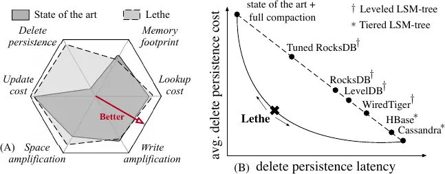
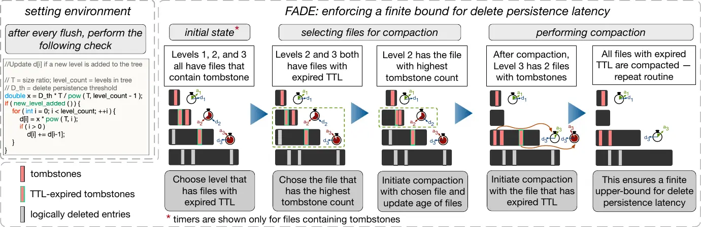
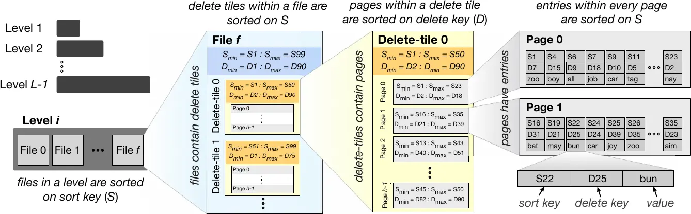
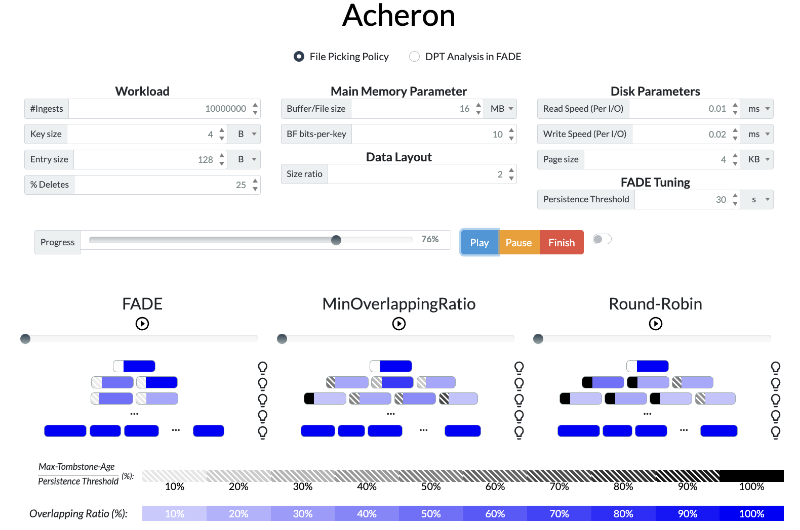
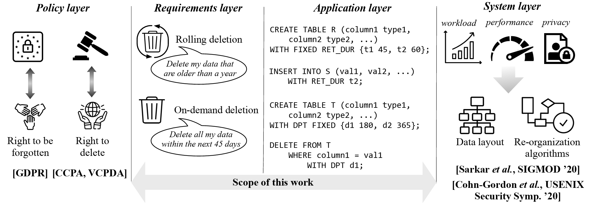

Modern privacy regulations give every user the right to have their personal data deleted *promptly*: the *right to be forgotten* in the EU's **GDPR** obliges service providers to comply with erasure requests within 30–60 days, California's **CCPA**/**CPRA** require acknowledgment within 10 days and a response within 45, and Virginia's **VCDPA** allows 45 business days <a class="rp-cite" href="#pub-4">[4]</a>. Non-compliance is expensive — between January 2020 and January 2022 alone, GDPR penalties amounted to **$1.2B**, including fines against Amazon ($877M), WhatsApp ($255M), Google Ireland ($102M), and Facebook ($68M) <a class="rp-cite" href="#pub-4">[4]</a>.

Meanwhile, the data systems holding that data are built for the opposite goal. To sustain high ingestion rates, modern storage engines embrace the *out-of-place* paradigm — every write, including a delete, is an append. A delete merely inserts a *tombstone* that logically invalidates older entries; the physical data may linger in storage for an *unbounded* period of time <a class="rp-cite" href="#pub-6">[6]</a>. And deletes are not rare events: ZippyDB, a distributed key-value engine storing metadata for images and videos, processes **25.2M delete requests in a 24-hour window — 6% of its entire workload** <a class="rp-cite" href="#pub-2">[2]</a>. The result is a fundamental mismatch between what regulations require and what state-of-the-art engines can deliver — in principle, *the design goals of out-of-place systems are antithetical to those of timely delete persistence* <a class="rp-cite" href="#pub-5">[5]</a>.

This project closes that gap end-to-end — at the **engine layer** <a class="rp-cite" href="#pub-2">[2]</a><a class="rp-cite" href="#pub-6">[6]</a>, the **visualization layer** <a class="rp-cite" href="#pub-1">[1]</a>, and the **language and policy layer** <a class="rp-cite" href="#pub-3">[3]</a><a class="rp-cite" href="#pub-4">[4]</a><a class="rp-cite" href="#pub-7">[7]</a> — turning *delete* into a first-class operation with a bounded, user-specified persistence latency.

<blockquote class="rp-pull">
How to persist deletes in a time-bound fashion without affecting the read/write performance of an LSM-engine, while supporting both primary and secondary range deletes?
</blockquote>

## Where It Started: Deletion as a Right

The thread began before the systems work, with the question of what GDPR enforcement *means* technically <a class="rp-cite" href="#pub-7">[7]</a>. In a multi-stakeholder service architecture — data subjects producing data, a data controller provisioning the service, data processors (cloud and fog providers) computing on the data — honoring the *right to erasure* requires that (i) replication and dissemination of the data under erasure be stopped, and (ii) every replica held by the controller and all processors be erased, *without undue delay*. That work identified the core research challenges: a policy language in which users express retention preferences, enforcement of those policies across administrative domains, and — most stubbornly — system-level mechanisms that can actually delete data on time. The rest of this project is an answer to that last challenge.

## The Problem: State-of-the-Art Engines Fail to Persist Deletes

LSM-trees power the storage layer of most modern data systems — RocksDB, LevelDB, BigTable, X-Engine, DynamoDB, Cassandra, HBase, MyRocks, CockroachDB. They achieve their celebrated ingestion throughput by being out-of-place: writes accumulate in a memory buffer and are flushed as immutable sorted runs, which background *compactions* progressively sort-merge. A tombstone — and the obsolete entries it shadows — can only be physically purged when it is compacted with the **last level** of the tree <a class="rp-cite" href="#pub-6">[6]</a>.

Two structural problems follow:

1. **Delete persistence latency is unbounded.** A tombstone must traverse every level of an exponentially growing tree, and that traversal is driven by the *unique-insertion rate* and the *current tree height* — neither of which the application controls. Worse, adversarial-but-realistic workloads (interleaved inserts and deletes on recently inserted keys) keep recycling tombstones through compactions in the upper levels *indefinitely* <a class="rp-cite" href="#pub-2">[2]</a><a class="rp-cite" href="#pub-6">[6]</a>. Until purged, the retained invalid entries inflate **space amplification** (a tombstone of a few bytes can invalidate arbitrarily many larger entries), pollute the **Bloom filters** (raising false-positive rates for every lookup), and inflate **write amplification** (invalid entries are re-compacted again and again).

2. **Secondary range deletes require a full-tree compaction.** When the delete predicate is on an attribute other than the sort key — *"delete all entries with timestamp older than D days"* on a tree sorted by `id` — the qualifying entries are scattered across every level, every file, and every page. The only state-of-the-art remedy is to read, merge, and rewrite the *entire tree*: a stop-the-world operation whose cost is independent of how little data actually qualifies <a class="rp-cite" href="#pub-6">[6]</a>.

In production, engines paper over both problems with *periodic full-tree compactions* — typically every 15–30 days <a class="rp-cite" href="#pub-2">[2]</a>. Engineers on Alibaba's X-Engine team describe applications that retain data for 7 or 30 days and "*daily delete data that turned 31 days old, effectively purging 1/30 of the database every day*" — and report that forcing compactions to meet a delete-latency target "*leads to significant increase in compaction frequency, and the observed I/O utilization often peaks. This quickly introduces performance pains*" <a class="rp-cite" href="#pub-6">[6]</a>.

<figure>
  
  <figcaption>State-of-the-art LSM engines sit on a steep trade-off curve between delete persistence latency and its cost — from Cassandra and HBase (long latency, low cost) to periodic full-tree compaction (timely, but extremely expensive). Lethe carves out the knee of the curve: timely persistence at near-baseline cost <a class="rp-cite" href="#pub-6">[6]</a>.</figcaption>
</figure>

## Engine Layer: Lethe and Lethe+

**Lethe** <a class="rp-cite" href="#pub-6">[6]</a> and its journal extension **Lethe+** <a class="rp-cite" href="#pub-2">[2]</a> are the flagship contributions of this project: the first LSM engine to offer *user-defined delete persistence guarantees* while *improving* read performance. Lethe is built from two co-designed components — **FADE**, a family of delete-aware compaction policies that bound the delete persistence latency, and **KiWi**, a physical data layout that makes secondary range deletes practical — integrated into RocksDB with a fine-grained API for custom compaction triggers and file-picking policies.

### FADE: Bounding Delete Persistence Latency

FADE (**FA**st **DE**letion) takes a user- or SLA-provided *delete persistence threshold* — D<sub>th</sub>, e.g., "30 days" — and guarantees every tombstone reaches the last level within it. The mechanism is a per-file **time-to-live (TTL)**: D<sub>th</sub> is partitioned across the tree's levels as a geometric sequence matching the size ratio, so shallow levels (small, frequently compacted) get small TTL shares and deep levels (holding most of the data) get exponentially larger ones — guaranteeing files expire at a constant rate per time unit rather than all at once <a class="rp-cite" href="#pub-6">[6]</a>.

Compaction policy is then augmented on both sides. The *trigger* fires not only when a level saturates but also whenever any file's TTL expires; the *file picker* prefers files with expired TTLs or the highest tombstone count, rather than the production default of smallest overlap. Crucially, FADE's bookkeeping is free: it needs only the age of a file's oldest tombstone and an estimate of the entries it invalidates, both computable from metadata LSM engines already maintain (sequence numbers, per-file entry and delete counts) — *in practice, FADE leaves no metadata footprint* <a class="rp-cite" href="#pub-6">[6]</a>. FADE also suppresses *blind deletes* (tombstones against keys that don't exist) with a Bloom-filter probe, and the TODS article adds a formal proof that every tombstone is persisted within D<sub>th</sub> <a class="rp-cite" href="#pub-2">[2]</a>.

<figure>
  
  <figcaption>FADE in action <a class="rp-cite" href="#pub-6">[6]</a>: after every flush, per-level TTLs are recomputed; among levels holding expired files, FADE picks the file with the highest tombstone count and compacts it downward — ensuring a finite upper bound on delete persistence latency.</figcaption>
</figure>

### KiWi: A Storage Layout for Secondary Range Deletes

FADE bounds the latency of deletes on the *sort key*, but cannot help when the delete key differs from it. **KiWi** (**K**ey **W**eav**i**ng Storage Layout) attacks this by adding one new layer to the LSM storage hierarchy: the **delete tile**, sitting between a file and its pages. The layout *interweaves* the two key orders — within a level, files are sorted on the sort key *S*; within a file, delete tiles are sorted on *S*; within a delete tile, pages are sorted on the **delete key *D***; and within each page, entries are sorted on *S* again <a class="rp-cite" href="#pub-6">[6]</a>.

<figure>
  
  <figcaption>The Key Weaving Storage Layout <a class="rp-cite" href="#pub-6">[6]</a>: delete tiles within a file are sorted on the sort key (S); pages within a delete tile are sorted on the delete key (D); entries within each page are sorted on S. Entries qualifying for a secondary range delete cluster into contiguous pages that can be dropped wholesale.</figcaption>
</figure>

This interweaving has a remarkable consequence: the entries qualifying for a secondary range delete populate *contiguous pages* of each delete tile, which can be **dropped wholesale** — released to the file system without ever being read, merged, or rewritten (*full page drops*). Only the pages at the edges of the delete range need in-place editing (*partial page drops*, at most one per tile). Because each page remains internally sorted on *S* and Bloom filters move to page granularity (with the same total memory), point lookups retain state-of-the-art efficiency; the modest extra cost is more filter probes — and since hashing a key takes ~80ns against ~100µs for an SSD access, the CPU overhead is three orders of magnitude beneath the I/O it saves <a class="rp-cite" href="#pub-6">[6]</a>.

The single knob is the delete-tile granularity *h* (pages per tile): *h* = 1 degenerates to the classical layout; larger *h* serves more of each delete by full-page drops at a tunable penalty to short range lookups. Lethe derives the *optimal* *h* in closed form from just the workload mix — the frequencies of point queries, short range queries, and secondary range deletes <a class="rp-cite" href="#pub-6">[6]</a>. **KiWi+** <a class="rp-cite" href="#pub-2">[2]</a> goes one step further and assigns a *different* granularity h<sub>i</sub> to every level: shallow levels — which serve a disproportionate share of early-terminating point lookups — get small tiles, deep levels get large ones. KiWi+ simultaneously reduces the memory of delete fence pointers and the CPU cost of filter probes, and pushes the read/delete Pareto frontier closer to the theoretical optimum. The TODS article also extends both layouts to *tiered* LSM designs (the optimal leveled tile is exactly √T̄ larger than the tiered one), making Lethe+ applicable to engines like HBase and Cassandra <a class="rp-cite" href="#pub-2">[2]</a>.

### Key Results

<div class="rp-metrics">
  <div class="rp-metric"><span class="rp-metric-value">1.17–1.4×</span><span class="rp-metric-label">Higher read throughput vs. RocksDB <a class="rp-cite" href="#pub-2">[2]</a></span></div>
  <div class="rp-metric"><span class="rp-metric-value">2.1–9.8×</span><span class="rp-metric-label">Lower space amplification, with only 10% deletes in the workload <a class="rp-cite" href="#pub-6">[6]</a></span></div>
  <div class="rp-metric"><span class="rp-metric-value">&lt; 1%</span><span class="rp-metric-label">Write-amplification overhead after amortization <a class="rp-cite" href="#pub-2">[2]</a></span></div>
  <div class="rp-metric"><span class="rp-metric-value">76%</span><span class="rp-metric-label">Lower I/O cost for secondary range deletes via full-page drops <a class="rp-cite" href="#pub-6">[6]</a></span></div>
</div>

Purging invalidated entries persistently cleans up the Bloom filters and lowers their false-positive rate, delivering **1.17–1.4× higher read throughput** — lookups especially on deleted keys return with fewer disk I/Os than RocksDB. With just 10% deletes in the workload, timely purging keeps the tree nearly free of invalidated entries instead of letting them accumulate across levels, cutting space amplification by **2.1–9.8×**. Eager merging makes Lethe write more data early in a workload, but the cost amortizes as later compactions touch fewer invalid entries — settling to **under 1% write-amplification overhead** over the lifetime of the workload. At the closed-form optimal delete-tile size, KiWi's full-page drops realize a secondary range delete at a fraction of the cost of RocksDB's full-tree compaction, achieving **76% lower I/O cost** — with no loss in read performance.

## Visualization Layer: Acheron

Tombstone dynamics are notoriously hard to reason about — they emerge from tree shape, workload, compaction trigger, and file-picking policy in ways no single benchmark number reveals. **Acheron** <a class="rp-cite" href="#pub-1">[1]</a> is a demonstration system that lets researchers and practitioners *watch* the life cycle of tombstones: it runs **FADE**, **MinOverlappingRatio** (the production default), and **Round-Robin** compaction policies *simultaneously* on identical inputs, animating the evolution of three LSM trees side by side.

<figure>
  
  <figcaption>The Acheron UI <a class="rp-cite" href="#pub-1">[1]</a>: a single panel configures workload (ingestion volume, key/entry size, % deletes), memory, disk, and the FADE persistence threshold; three synchronized panels animate tombstone propagation under competing compaction policies, with twelve performance metrics updating live.</figcaption>
</figure>

In the visualization, every file is a rectangle whose striped fraction shows its tombstone share and whose darkness encodes the age of its oldest tombstone — when a tombstone outlives the persistence threshold, the stripe turns fully dark. Watching the animation makes the project's central claim immediately legible: under the state-of-the-art policies, dark (expired) tombstones accumulate and linger; under FADE, they never appear. Acheron is publicly available at <a href="https://disc-projects.bu.edu/acheron/research.html" target="_blank" rel="noopener">disc-projects.bu.edu/acheron</a>.

## Language & Policy Layer

A perfect engine is useless if applications cannot *ask* it for bounded-latency deletion. From the regulations we distill two classes of deletion requests <a class="rp-cite" href="#pub-4">[4]</a>: **retention-driven deletes** ("delete my data older than a year" — rolling, set once) and **on-demand deletes** ("delete all my data within the next 45 days" — ad hoc, user-triggered). State-of-the-art SQL can express neither. Our EDBT extensions <a class="rp-cite" href="#pub-4">[4]</a> add a `RET_DUR` clause (retention duration) and a `DPT` clause (delete persistence threshold) to the DDL and DML, each supporting both pre-declared (`FIXED`) and ad hoc (`ARBITRARY`) thresholds:

```sql
CREATE TABLE T (column1 type1, column2 type2, ...)
WITH RET_DUR {ARBITRARY | FIXED (t1 <ret1>, t2 <ret2>, ...)}
WITH DPT     {ARBITRARY | FIXED (d1 <dpt1>, d2 <dpt2>, ...)};

INSERT INTO T (val1, val2, ...) WITH RET_DUR t1;

DELETE FROM T WHERE column1 = val1 WITH DPT d1;
```

The extensions are small and template-portable to other query languages (GraphQL, LINQ, N1QL), but they transform retention and deletion from out-of-band operational scripts into first-class declarative intent that the engine — Lethe underneath — can honor and audit.

The **deletion-compliance framework** <a class="rp-cite" href="#pub-3">[3]</a><a class="rp-cite" href="#pub-5">[5]</a> ties the whole stack together in a four-layer architecture: a **policy layer** (the regulations: right to be forgotten, right to delete, deletion right), a **requirements layer** (retention-driven vs. on-demand deletion), an **application layer** (the declarative SQL surface above), and a **system layer** (delete-aware data layouts and re-organization algorithms — FADE and KiWi). The regulation determines *what* must be deleted and *when*; the language lets the user *express* it; the engine *guarantees* it.

<figure>
  
  <figcaption>The four-layer framework for privacy-through-deletion <a class="rp-cite" href="#pub-3">[3]</a><a class="rp-cite" href="#pub-4">[4]</a>: regulations (policy) are distilled into deletion requirements, expressed through SQL extensions (application), and realized by delete-aware layouts and re-organization algorithms (system).</figcaption>
</figure>

## Outlook

The deletion thread remains open-ended. The most consequential open problem is **proving compliance**: today, companies demonstrate regulation compliance through inspection of code and legal substantiation; the goal is data systems with lightweight checks that can *prove* a deletion request was honored — tracking data flow within the system and securing deletion at the device level <a class="rp-cite" href="#pub-4">[4]</a>. On the engine side, the same piggybacking principle generalizes beyond LSM-trees to any out-of-place design — B<sup>+</sup>-tree and B<sup>ε</sup>-tree engines, delta stores in relational and columnar systems — by hooking timely deletion into each system's native consolidation routine <a class="rp-cite" href="#pub-5">[5]</a>. The driving belief is simple: in a regulated world, delete is no longer a maintenance operation. It is a guarantee.

## Relevant Publications

<ol class="rp-pubs">
  <li id="pub-1"><span class="rp-pub-authors">Zichen Zhu, Subhadeep Sarkar, Manos Athanassoulis.</span> <span class="rp-pub-title">Acheron: Persisting Tombstones in LSM Engines.</span> <span class="rp-pub-venue">ACM SIGMOD Demo 2023.</span><span class="rp-pub-links"><a href="/assets/fulltext/Acheron_Persisting_Tombstones_in_LSM_Engines.pdf" target="_blank" rel="noopener" class="pub-icon" role="button" aria-label="PDF"><i class="fa-regular fa-file-pdf"></i></a><a href="https://disc-projects.bu.edu/acheron/research.html" target="_blank" rel="noopener" class="pub-icon" role="button" aria-label="Website"><i class="fa-solid fa-globe"></i></a></span></li>
  <li id="pub-2"><span class="rp-pub-authors">Subhadeep Sarkar, Tarikul Islam Papon, Dimitris Staratzis, Zichen Zhu, Manos Athanassoulis.</span> <span class="rp-pub-title">Enabling Timely and Persistent Deletion in LSM-Engines.</span> <span class="rp-pub-venue">ACM TODS 2023.</span><span class="rp-pub-links"><a href="/assets/fulltext/Enabling_Timely_and_Persistent_Deletion_in_LSM-Engines.pdf" target="_blank" rel="noopener" class="pub-icon" role="button" aria-label="PDF"><i class="fa-regular fa-file-pdf"></i></a><a href="https://github.com/BU-DiSC/KiWi-Codebase" target="_blank" rel="noopener" class="pub-icon" role="button" aria-label="Code"><i class="fa-brands fa-github"></i></a></span></li>
  <li id="pub-3"><span class="rp-pub-authors">Manos Athanassoulis, Subhadeep Sarkar, Tarikul Islam Papon, Zichen Zhu, Dimitris Staratzis.</span> <span class="rp-pub-title">Building Deletion-Compliant Data Systems.</span> <span class="rp-pub-venue">IEEE Data Engineering Bulletin 2022.</span><span class="rp-pub-links"><a href="/assets/fulltext/Building_Deletion-Compliant_Data_Systems.pdf" target="_blank" rel="noopener" class="pub-icon" role="button" aria-label="PDF"><i class="fa-regular fa-file-pdf"></i></a></span></li>
  <li id="pub-4"><span class="rp-pub-authors">Subhadeep Sarkar, Manos Athanassoulis.</span> <span class="rp-pub-title">Query Language Support for Timely Data Deletion.</span> <span class="rp-pub-venue">EDBT 2022.</span><span class="rp-pub-links"><a href="/assets/fulltext/Query_Language_Support_for_Timely_Data_Deletion.pdf" target="_blank" rel="noopener" class="pub-icon" role="button" aria-label="PDF"><i class="fa-regular fa-file-pdf"></i></a></span></li>
  <li id="pub-5"><span class="rp-pub-authors">Subhadeep Sarkar.</span> <span class="rp-pub-title">Toward Building Deletion Compliant Data Systems.</span> <span class="rp-pub-venue">HPTS 2022.</span><span class="rp-pub-links"><a href="/assets/fulltext/Toward_Building_Deletion_Compliant_Data_Systems.pdf" target="_blank" rel="noopener" class="pub-icon" role="button" aria-label="PDF"><i class="fa-regular fa-file-pdf"></i></a><a href="/assets/resources/HPTS.pdf" target="_blank" rel="noopener" class="pub-icon" role="button" aria-label="Slides"><i class="fa-solid fa-chalkboard"></i></a></span></li>
  <li id="pub-6"><span class="rp-pub-authors">Subhadeep Sarkar, Tarikul Islam Papon, Dimitris Staratzis, Manos Athanassoulis.</span> <span class="rp-pub-title">Lethe: A Tunable Delete-Aware LSM Engine.</span> <span class="rp-pub-venue">ACM SIGMOD 2020.</span><span class="rp-pub-links"><a href="/assets/fulltext/Lethe_A_Tunable_Delete-Aware_LSM_Engine.pdf" target="_blank" rel="noopener" class="pub-icon" role="button" aria-label="PDF"><i class="fa-regular fa-file-pdf"></i></a><a href="/assets/resources/Lethe-slides_SIGMOD.pdf" target="_blank" rel="noopener" class="pub-icon" role="button" aria-label="Slides"><i class="fa-solid fa-chalkboard"></i></a><a href="/assets/resources/Lethe-poster_NEDBD.pdf" target="_blank" rel="noopener" class="pub-icon" role="button" aria-label="Poster"><i class="fa-regular fa-image"></i></a><a href="https://github.com/BU-DiSC/lethe-codebase" target="_blank" rel="noopener" class="pub-icon" role="button" aria-label="Code"><i class="fa-brands fa-github"></i></a><a href="https://disc-projects.bu.edu/lethe/" target="_blank" rel="noopener" class="pub-icon" role="button" aria-label="Website"><i class="fa-solid fa-globe"></i></a></span></li>
  <li id="pub-7"><span class="rp-pub-authors">Subhadeep Sarkar, Jean-Pierre Banâtre, Louis Rilling, Christine Morin.</span> <span class="rp-pub-title">Towards Enforcement of the EU GDPR: Enabling Data Erasure.</span> <span class="rp-pub-venue">IEEE iThings 2018.</span><span class="rp-pub-links"><a href="/assets/fulltext/Towards_Enforcement_of_the_EU_GDPR_Enabling_Data_Erasure.pdf" target="_blank" rel="noopener" class="pub-icon" role="button" aria-label="PDF"><i class="fa-regular fa-file-pdf"></i></a></span></li>
</ol>
