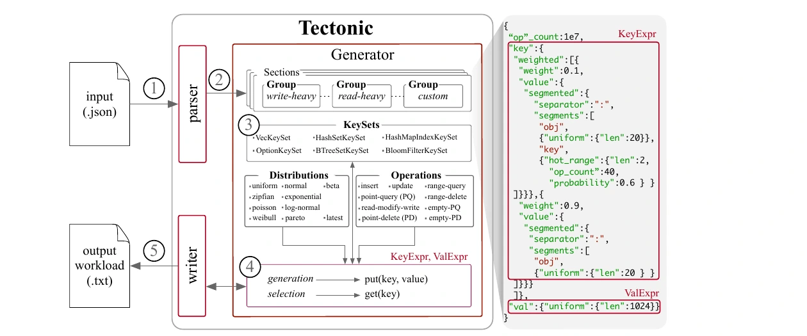
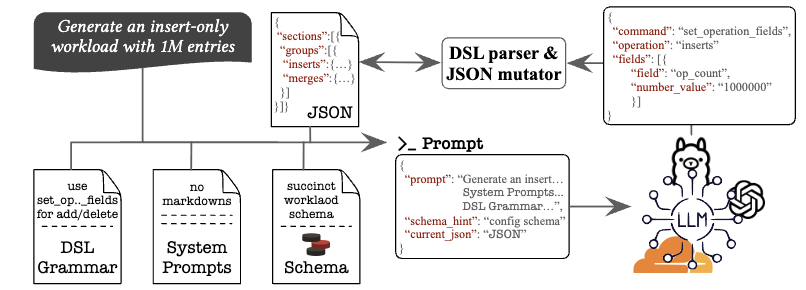
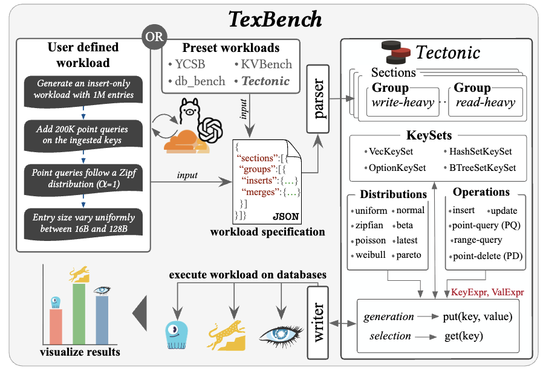

Credible storage-systems research depends on credible benchmarks. Yet the community's standard tools — YCSB, db_bench, and their derivatives — were designed for a simpler era. They cannot distinguish empty from non-empty point queries, force every operation type onto the same key distribution, cannot generate workloads that evolve over time, and cannot model the composite-key structures and near-sorted arrival patterns that dominate real production traces <a class="rp-cite" href="#pub-1">[1]</a><a class="rp-cite" href="#pub-2">[2]</a>. The result is a systematic mismatch between the workloads our systems are evaluated on and the workloads they actually face in deployment — leading to poor benchmarking and, ultimately, suboptimal system optimizations.

Our benchmarking research closes this gap through a sequence of three tools, each extending the reach of the previous one: **KVBench** <a class="rp-cite" href="#pub-2">[2]</a> expands the operation and distribution vocabulary of key-value workloads; **Tectonic** <a class="rp-cite" href="#pub-1">[1]</a> adds the temporal, structural, and dynamic properties of production workloads at a fraction of the resource cost; and **TexBench** <a class="rp-cite" href="#pub-4">[4]</a><a class="rp-cite" href="#pub-5">[5]</a> removes the specification barrier altogether, generating benchmark workloads from natural-language descriptions and comparing multiple key-value stores against them side by side.

<blockquote class="rp-pull">
If our benchmarks cannot reproduce real workloads, how do we know our systems are actually fast?
</blockquote>

## The Problem: Standard Benchmarks Miss Real Workload Structure

Four limitations make state-of-the-art workload generators systematically misleading for modern storage research <a class="rp-cite" href="#pub-1">[1]</a><a class="rp-cite" href="#pub-2">[2]</a>:

1. **No distinction between empty and non-empty queries.** A point lookup on an existing key exercises the full read path — buffer scan, Bloom filter, block I/O — while a lookup on a non-existent key can short-circuit at the Bloom filter or zonemap. These have very different performance implications, yet YCSB cannot generate empty point queries at all, and db_bench emulates them crudely (by lengthening the key), so the two can never be interleaved in one workload <a class="rp-cite" href="#pub-2">[2]</a>.

2. **Forced identical distributions across operation types.** In a social-media workload, updates and searches concentrate on popular hashtags (Zipfian) while searches for non-existent tags are spread uniformly. Every state-of-the-art generator forces inserts, updates, and queries to share one distribution, masking exactly these patterns <a class="rp-cite" href="#pub-2">[2]</a>.

3. **No dynamic workloads.** Production workloads at Meta — UDB, ZippyDB, UP2X — vary over a 7-day window in composition, distribution, access pattern, and entry size; UDB writes peak daily at 17:00 PST, and some column families see up to a 10× jump in query frequency on weekends <a class="rp-cite" href="#pub-1">[1]</a>. The only way to emulate this with existing tools is to generate workload segments separately and stitch them together by hand — which breaks key-sharing across phases and undermines the evaluation's accuracy.

4. **No composite keys or controlled sortedness.** Production keys are frequently synthetic composites — `cf-EMP:edge:alex` — whose prefixes encode origin and domain, and data often arrives *nearly* sorted on the ingestion attribute. No standard generator can model prefix-structured keys, and none can generate data at a target sortedness while interleaving other operations <a class="rp-cite" href="#pub-1">[1]</a>.

Deletes compound all four: 6% of all operations processed by ZippyDB are deletes, yet YCSB does not support deletes on existing keys, and db_bench cannot interleave deletes with queries and updates <a class="rp-cite" href="#pub-2">[2]</a>.

## KVBench: A Richer Operation and Distribution Surface

**KVBench** <a class="rp-cite" href="#pub-2">[2]</a> is a C++ workload generator that attacks the first two limitations — and the delete problem — head-on. Its central design decision is to track the *live key set* during generation (a hash set for membership, a vector for random access), which is what makes the new workload classes possible:

- **Empty vs. non-empty query control** — the empty-query fraction is a first-class knob (`-Z`), and empty and non-empty point queries can be freely interleaved in one workload, each with its *own* distribution
- **Independent distributions per operation type** — inserts (via key prefixes), updates, and empty and non-empty point queries each choose from uniform, normal, beta, and Zipfian distributions with configurable parameters
- **Consistency-preserving deletes** — because the live key set is tracked, point and range deletes always target existing keys and can be interleaved with inserts, updates, and queries without breaking workload validity
- **Selectivity-aware range operations** — both range queries and range deletes take an explicit selectivity parameter, enabling benchmarks that stress secondary-delete and scan paths at controlled result sizes

KVBench ships with five benchmark workloads inspired by real applications and unsupported by prior tools — among them an 80%-empty-query workload (product searches for out-of-stock items), a fully interleaved insert/delete/query/update mix (social-media activity), a multi-distribution update/query workload (Zipfian updates on popular posts, uniform empty searches), an update + range-delete workload (inventory clearance), and an insert-heavy workload with Zipfian key prefixes (IoT timestamps skewed toward daytime) <a class="rp-cite" href="#pub-2">[2]</a>.

These new axes immediately expose behavior invisible to YCSB: on RocksDB, average query latency drops by more than **5×** as the empty-query fraction sweeps from 0 to 100% — and two workloads with *identical composition* differ by **1.6× in throughput** depending on whether operations are executed sequentially or interleaved <a class="rp-cite" href="#pub-2">[2]</a>.

## Tectonic: Dynamic, Production-Like Workloads at Scale

**Tectonic** <a class="rp-cite" href="#pub-1">[1]</a> generalizes the approach into a full benchmarking suite, implemented in Rust, that models the *temporal and structural* dimensions KVBench leaves open. To the best of our knowledge, Tectonic is the first key-value benchmark that supports benchmarking storage engines under dynamically shifting workloads.

<figure>
  
  <figcaption>The components of Tectonic <a class="rp-cite" href="#pub-1">[1]</a>: a declarative JSON specification of Sections and Groups is parsed into a generation plan; an ActiveKeySet — backed by the data structure best suited to the operation mix — tracks live keys; and per-operation key/value expressions drive generation and selection before the writer emits the workload.</figcaption>
</figure>

A workload is a declarative JSON specification structured as **Sections** — isolated phases with independent keyspaces — each containing **Groups** of interleaved operations that share a keyspace with the phases before them. Every operation carries its own key distribution, drawn from **nine** supported families (uniform, normal, beta, Zipfian, exponential, log-normal, Poisson, Weibull, Pareto). On top of this, Tectonic provides:

- **Dynamic workload shifts** — a write-heavy burst phase followed by a read-heavy serving phase, with either shared or disjoint keyspaces, modeling the diurnal and event-driven patterns of production traces; transitions can be discrete or gradual across phases
- **Composite and prefix-structured keys** — keys assembled from independently distributed segments, reproducing patterns like `product:<vendor_id>:<sku>` and `order_history:<user_id>:<timestamp>`
- **Hot key ranges** — prefix-defined hot regions with configurable access probability, emulating the flash-sale skew of UDB-class workloads
- **Tunable sortedness** — ingestion at a user-specified (K, L)-sortedness <a class="rp-cite" href="#pub-3">[3]</a>, with string and composite keys, arbitrary distributions, and full interleaving with other operations — none of which the earlier BoDS benchmark supports

Efficiency is not incidental: workload generation is CPU-bound, and a slow generator becomes the bottleneck of the very experiment it drives. Tectonic generates the YCSB workload suite **10× faster than YCSB itself and 12× faster than KVBench**, with **84% lower memory footprint** than YCSB; at scale (1M–100M operations) it sustains **1.6× and 6.4× higher generation throughput** than YCSB and KVBench, respectively <a class="rp-cite" href="#pub-1">[1]</a>. Fidelity is preserved: a 20M-operation workload generated by Tectonic and by YCSB from the same specification produces less than **1% difference** in total bytes read and written — and identical cache behavior — when executed on RocksDB <a class="rp-cite" href="#pub-1">[1]</a>.

## TexBench: Benchmarks from Natural Language

The remaining barrier is the specification itself: composing a faithful multi-phase workload still demands expertise in the generator's configuration language. **TexBench** <a class="rp-cite" href="#pub-4">[4]</a><a class="rp-cite" href="#pub-5">[5]</a> removes it. The user describes the workload in plain language ("*generate an insert-only workload with 1M entries; add 200K point queries on the ingested keys, Zipfian with α=1; entry sizes uniform between 16B and 128B*"), and an LLM-driven pipeline translates the description into a validated Tectonic JSON specification.

<figure>
  
  <figcaption>TexBench constrains the LLM with a DSL grammar, system prompts, and a succinct workload schema; the model emits structured field-level commands that a DSL parser and JSON mutator apply to the specification — keeping generation grounded and auditable rather than free-form.</figcaption>
</figure>

The key design choice is that the LLM does not write the JSON directly: it emits commands in a small DSL (e.g., `set_operation_fields`) that a parser and JSON mutator apply to the specification, with the schema and grammar supplied in the prompt. This bounds the model's output to valid mutations, making the pipeline robust to hallucination. TexBench also ships preset translations of the YCSB, KVBench, db_bench, and Tectonic workload suites, so a single natural-language interface covers the community's existing benchmarks and the full expressiveness of Tectonic beneath it <a class="rp-cite" href="#pub-5">[5]</a>.

<figure>
  
  <figcaption>TexBench end to end <a class="rp-cite" href="#pub-4">[4]</a><a class="rp-cite" href="#pub-5">[5]</a>: a preset (YCSB, KVBench, db_bench, Tectonic) or a plain-language description becomes a Tectonic workload specification; Tectonic generates the workload, executes it on each selected database, and the results are visualized side by side.</figcaption>
</figure>

TexBench is also a *unified* benchmarking front end. Instead of installing and learning several suites and wiring each database up by hand, users pick or describe a workload once, run it against several key-value stores in parallel — RocksDB, Cassandra, ScyllaDB, and Redis today — and compare their performance in one interface <a class="rp-cite" href="#pub-4">[4]</a><a class="rp-cite" href="#pub-5">[5]</a>. Constraining the model pays off measurably: with Llama 3.2, TexBench responds on average **16.7× faster** than raw prompting (which took over 150 s for 39 of 50 requests) and captures the user's intent in **61%** of cases versus **4.7%**; even with GPT-4o it is more accurate than raw prompting (96.3% vs. 91.3%) while sending far smaller prompts <a class="rp-cite" href="#pub-5">[5]</a>.

## Key Results

  

    12×
    faster workload generation than KVBench (10× faster than YCSB itself) <a class="rp-cite" href="#pub-1">[1]</a>
  

  

    84%
    lower memory footprint than YCSB during generation <a class="rp-cite" href="#pub-1">[1]</a>
  

  

    &lt; 1%
    deviation in database I/O when replaying the same spec as YCSB on RocksDB <a class="rp-cite" href="#pub-1">[1]</a>
  

  

    1.6×
    throughput gap between sequential and interleaved workloads of identical composition <a class="rp-cite" href="#pub-2">[2]</a>
  

  

    16.7×
    faster responses than raw LLM prompting when turning a description into a workload (Llama 3.2) <a class="rp-cite" href="#pub-5">[5]</a>
  

  

    61%
    of requests whose intent TexBench captures with Llama 3.2 — vs. 4.7% for raw prompting <a class="rp-cite" href="#pub-5">[5]</a>
  

## Outlook

The through-line of this project is lowering the cost of asking realistic questions. KVBench made new workload classes *expressible*; Tectonic made them *dynamic and cheap to generate*; TexBench makes them *accessible* to anyone who can describe their application. The next step is closing the loop with real deployments — deriving generator specifications directly from production traces so that any observed workload can be reproduced, perturbed, and stress-tested in the lab. Benchmarking, done right, is not an afterthought of systems research; it is the instrument that keeps the rest of it honest.

## Relevant Publications

<ol class="rp-pubs">
  <li id="pub-1">Alexander H. Ott, Shubham Kaushik, Boao Chen, Subhadeep Sarkar. Tectonic: Bridging Synthetic and Real-World Workloads for Key-Value Benchmarking. TPCTC 2025.<a href="/assets/fulltext/Tectonic_Bridging_Synthetic_and_Real-World_Workloads_for_Key-Value_Benchmarking.pdf" target="_blank" rel="noopener" class="pub-icon" role="button" aria-label="PDF"><i class="fa-regular fa-file-pdf"></i></a><a href="/assets/resources/Tectonic_TPCTC.pdf" target="_blank" rel="noopener" class="pub-icon" role="button" aria-label="Slides"><i class="fa-solid fa-chalkboard"></i></a><a href="https://github.com/SSD-Brandeis/tectonic" target="_blank" rel="noopener" class="pub-icon" role="button" aria-label="Code"><i class="fa-brands fa-github"></i></a></li>
  <li id="pub-2">Zichen Zhu, Arpita Saha, Manos Athanassoulis, Subhadeep Sarkar. KVBench: A Key-Value Benchmarking Suite. DBTest @ ACM SIGMOD 2024.<a href="/assets/fulltext/KVBench_A_Key-Value_Benchmarking_Suite.pdf" target="_blank" rel="noopener" class="pub-icon" role="button" aria-label="PDF"><i class="fa-regular fa-file-pdf"></i></a><a href="/assets/resources/KVBench_TPCTC.pdf" target="_blank" rel="noopener" class="pub-icon" role="button" aria-label="Slides"><i class="fa-solid fa-chalkboard"></i></a><a href="https://github.com/BU-DiSC/kv-bench" target="_blank" rel="noopener" class="pub-icon" role="button" aria-label="Code"><i class="fa-brands fa-github"></i></a></li>
  <li id="pub-3">Aneesh Raman, Konstantinos Karatsenidis, Subhadeep Sarkar, Matthaios Olma, Manos Athanassoulis. BoDS: A Benchmark on Data Sortedness. TPCTC 2022.<a href="/assets/fulltext/BODS_A_Benchmark_on_Data_Sortedness.pdf" target="_blank" rel="noopener" class="pub-icon" role="button" aria-label="PDF"><i class="fa-regular fa-file-pdf"></i></a></li>
  <li id="pub-4">Abhishek Chanda, Shubham Kaushik, Artem Lavrov, Subhadeep Sarkar. TexBench: A Unified Benchmarking Suite for Shifting Workloads. VLDB 2026 (Demo).<a href="/assets/fulltext/TexBench_A_Unified_Benchmarking_Suite_for_Shifting_Workloads.pdf" target="_blank" rel="noopener" class="pub-icon" role="button" aria-label="PDF"><i class="fa-regular fa-file-pdf"></i></a><a href="https://github.com/SSD-Brandeis/TexBench" target="_blank" rel="noopener" class="pub-icon" role="button" aria-label="Code"><i class="fa-brands fa-github"></i></a></li>
  <li id="pub-5">Shubham Kaushik, Abhishek Chanda, Subhadeep Sarkar. TexBench: Harnessing LLMs for Efficient Key-Value Benchmarking. TPCTC 2026.<a href="/assets/fulltext/TexBench_Harnessing_LLMs_for_Efficient_Key-Value_Benchmarking.pdf" target="_blank" rel="noopener" class="pub-icon" role="button" aria-label="PDF"><i class="fa-regular fa-file-pdf"></i></a><a href="/assets/resources/TexBench_TPCTC.pdf" target="_blank" rel="noopener" class="pub-icon" role="button" aria-label="Slides"><i class="fa-solid fa-chalkboard"></i></a><a href="https://github.com/SSD-Brandeis/TexBench" target="_blank" rel="noopener" class="pub-icon" role="button" aria-label="Code"><i class="fa-brands fa-github"></i></a></li>
</ol>
