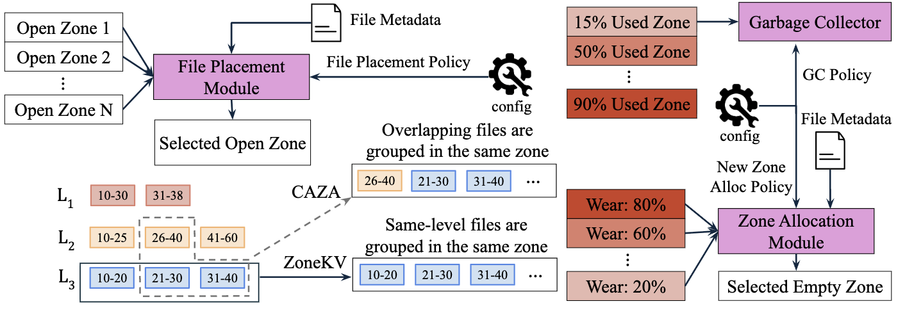

Modern storage hardware has undergone a fundamental shift. Zoned Namespace (ZNS) SSDs divide the logical address space into fixed-size zones that permit *only sequential writes* and can be erased only at zone granularity — and, in exchange for higher throughput, lower tail latency, and better endurance, they transfer the responsibilities of file placement, empty-zone selection, and garbage collection (GC) from the flash controller to the host application <a class="rp-cite" href="#pub-1">[1]</a>. Storage engines designed for rotating disks or conventional SSDs carry forward assumptions that no longer hold — and the performance consequences are severe.

The opportunity is equally fundamental. LSM-trees and ZNS SSDs align naturally: both write immutable files sequentially, and both accumulate logically invalidated data that must be periodically reclaimed — through compaction on the LSM side, through GC on the device side. When these two reclamation processes are designed in isolation, they duplicate work and multiply write amplification. Our research co-designs them. The flagship effort is **ZARC** (Zone Allocation & Reclamation after Compaction) <a class="rp-cite" href="#pub-1">[1]</a>, a unified framework that exposes the full design space of file placement, garbage collection, and zone allocation policies — and lets each LSM level pick its own. Beneath the host, **SilentZNS** <a class="rp-cite" href="#pub-2">[2]</a> fixes the device side of the bargain: it removes the hidden dummy writes that today's ZNS controllers issue whenever a partially written zone is closed, cutting device-level write amplification by 92%.

<blockquote class="rp-pull">
When both the LSM engine and the storage device reorganize data independently, they duplicate work. What happens when we make them cooperate?
</blockquote>

## The Problem: A Four-Way Trade-off, Optimized One Dimension at a Time

For an LSM engine on a ZNS SSD, performance is governed by a critical four-way trade-off <a class="rp-cite" href="#pub-1">[1]</a>:

1. **Compaction file picking** (LSM-side) — which files participate in a compaction — dictates when files become invalid, and thereby every file's *lifetime*
2. **File placement** (ZNS-side) — which files share a zone — determines how much valid data must be relocated before a zone can be reset
3. **Garbage collection** (ZNS-side) — when to reclaim, which zones to target, and when to stop
4. **New zone allocation** (ZNS-side) — which empty zone receives new writes — shapes wear distribution and the efficiency of all future GC

These four policies are tightly interdependent, yet the state of the art tunes them in isolation, each for a specific compaction strategy, SSD configuration, or workload. The failure modes are concrete:

**GC that stalls — or crashes.** ZenFS, the production RocksDB backend for ZNS devices, triggers GC through a slope-based heuristic: only zones below a computed valid-data ratio qualify as victims. When files from different LSM levels — with drastically different lifetimes — share a zone, *no* zone ever satisfies the threshold, and GC fails to reclaim space even though reclaimable zones exist. ZenFS also reserves no zones for relocation, so it can crash with reclaimable space still on the device — simply because there is nowhere to move the valid data <a class="rp-cite" href="#pub-1">[1]</a>.

**Placement that mispredicts lifetimes.** Vertical-partitioning policies (LIZA, CAZA) mix files from different levels in one zone, but cross-level lifetimes differ so much — and depend so heavily on the file-picking policy — that lifetime equalization is practically impossible. Horizontal policies avoid level mixing but ignore lifetime variation *within* a level (ZoneKV), or rank files by compaction order only to have the ranking go stale after every compaction (OAZA, Prophet) <a class="rp-cite" href="#pub-1">[1]</a>.

**No unified framework.** Because every proposal is evaluated in isolation, the community cannot answer the underlying question: how does the four-way trade-off behave across compaction policies, size ratios, zone sizes, and workloads? ZARC is built to make that question answerable.

## ZARC: One Framework, Level-Specific Policies

<figure>
  
  <figcaption>ZARC's three co-designed modules <a class="rp-cite" href="#pub-1">[1]</a>: the file placement module maps new files to open zones under a configurable policy (e.g., CAZA groups overlapping files across levels; ZoneKV groups same-level files); the garbage collector selects victim zones by valid-data share; and the zone allocation module picks empty zones by wear when placement needs a fresh zone.</figcaption>
</figure>

### File Placement Module

ZARC implements the four state-of-the-art placement baselines (LIZA, CAZA, ZoneKV, OAZA) and adds new ones: **Nearest**, a proximity-aware policy that places a file into the zone holding the most files with adjacent key ranges at the same level; a **delete-aware** policy — inspired by our Lethe work — that isolates tombstone-heavy files into separate zones; and **ranking-based** policies that score files by next-level overlap and tombstone-compensated size. The key structural idea is the **hybrid continuum**: because deeper levels hold fewer but far longer-lived files than upper levels, ZARC lets *every LSM level adopt a different placement policy* (with a per-level fallback), generating a large combinatorial space of level-specific strategies to match any configuration <a class="rp-cite" href="#pub-1">[1]</a>.

### Garbage Collector

ZARC-GC replaces the fragile slope heuristic with a design that guarantees forward progress. It wakes periodically and, whenever free space falls below a start threshold, reclaims zones — always choosing the victim with the *least valid data* — until a stop threshold is met. A small reserve of empty zones (5% by default) guarantees that valid files always have somewhere to go during relocation, and a locking mechanism prevents GC and foreground writes from contending, avoiding latency spikes. Thresholds, reserve size, and an optional wear-leveling mode (which migrates long-lived files toward high-wear zones) are all user-tunable <a class="rp-cite" href="#pub-1">[1]</a>.

### Zone Allocation Module

When no suitable open zone exists, ZARC selects an empty zone under a configurable policy: first-available (the ZenFS default, which wears out low-index zones disproportionately), round-robin, random, or **lifetime-based** — steering short-lived files to low-wear zones and long-lived files to high-wear zones, trading a sliver of write amplification for device longevity <a class="rp-cite" href="#pub-1">[1]</a>.

## SilentZNS: Removing the Hidden Cost Inside the Device

ZNS promises to eliminate device-side garbage collection, but the zoned abstraction hides substantial differences across SSD controller designs — and those differences surface as cost and unpredictability in the host <a class="rp-cite" href="#pub-2">[2]</a>. The culprit is zone management. Devices cap the number of open zones, so a system like RocksDB on ZenFS must regularly FINISH a partially written zone to open a new one; to satisfy device constraints, the baseline design then fills the rest of the zone with *dummy data* before sealing it. These invisible writes inflate **device-level write amplification (DLWA)**, accelerate flash wear, and compete with host I/O for the same channels. They also force the data system into an uncomfortable trade-off: keep half-empty zones open and pay in space amplification, or finish them early and pay in DLWA <a class="rp-cite" href="#pub-2">[2]</a>.

We trace the problem to four design choices inside the device — zone allocation granularity, zone geometry, write order, and zone mapping and management — and define a spectrum of mapping strategies built from allocation units of different granularity. **SilentZNS** departs from fixed logical-to-physical zone mapping: it assigns allocation units to a zone on demand as data arrives, applies RESET and FINISH at the granularity of those units, and writes dummy data only to partially written units — while allocating with wear in mind, preserving parallelism, and keeping read latency competitive <a class="rp-cite" href="#pub-2">[2]</a>. The payoff is a more predictable device, and one that lets the data system reclaim zones by logical lifetime and free-space needs rather than to dodge hidden device-side writes.

## Key Results

On a RocksDB/ZenFS prototype over simulated ZNS SSDs (ConfZNS++) on the Chameleon testbed, ZARC <a class="rp-cite" href="#pub-1">[1]</a>:

  

    86%
    less GC-induced data movement than ZenFS/LIZA (Hybrid-3, size ratio 2)
  

  

    0/10
    ZARC-GC crashes under tight space — where ZenFS GC crashed in all 10 runs
  

  

    8.6%
    reduction in GC data movement from victim selection alone (ZARC-GC vs. LIZA-GC)
  

  

    9%
    higher ingestion throughput than the ZenFS default (up to; Hybrid-3)
  

Two findings stand out. First, **hybrid placement wins big**: with size ratio 10, Hybrid-2 (naïve placement on levels 0–1, Nearest below) cuts data movement by 79% against LIZA and 66% against CAZA while matching their throughput; with size ratio 2, Hybrid-3 (CAZA on levels 0–1, Nearest below) reduces data movement by up to 86% — while also lowering write amplification. Second, and more consequential for the research agenda: **the best policy changes with the configuration**. Hybrid-2 dominates at one size ratio, Hybrid-3 at another, and Hybrid-3 pays for its data-movement wins with more zone resets — a data-movement-versus-wear trade-off that no single fixed policy resolves. This is precisely why a unified, navigable framework matters more than any individual heuristic <a class="rp-cite" href="#pub-1">[1]</a>.

Implemented in the ConfZNS++ emulator and evaluated with microbenchmarks and RocksDB on ZenFS, SilentZNS <a class="rp-cite" href="#pub-2">[2]</a>:

  

    92%
    lower device-level write amplification at a 10% zone-occupancy threshold, with space amplification held at 1.5
  

  

    12%
    less flash wear
  

  

    3.7×
    faster workload execution (up to)
  

## Outlook

ZARC is an early-stage effort, and the roadmap is deliberate: rigorous evaluation across workloads, compaction policies, and realistic device configurations; richer hybrid designs; and ultimately the *co-design of compaction file-picking policies with placement and GC* — closing the loop so that the LSM engine picks files to compact partly because of where they live on the device. ML-based estimation of file lifetimes is a natural next ingredient. SilentZNS supplies the other half of that loop: host-side placement can only pay off if the device stops charging hidden costs for the zones the host chooses to close. More broadly, ZNS is one instance of a general trend — computational storage and persistent memory pose the same question in different forms: when the device stops hiding its internals, the storage engine should stop pretending they don't exist.

## Relevant Publications

<ol class="rp-pubs">
  <li id="pub-1">Farhan S. Chowdhury, Shadman Saqib Eusuf, Subhadeep Sarkar, Tarikul Islam Papon. ZARC: Re-inventing Zone Allocation for LSMs on ZNS SSD. DaMoN 2026.<a href="/assets/fulltext/ZARC_Re-inventing_Zone_Allocation_for_LSMs_on_ZNS_SSD.pdf" target="_blank" rel="noopener" class="pub-icon" role="button" aria-label="PDF"><i class="fa-regular fa-file-pdf"></i></a></li>
  <li id="pub-2">Teona Bagashvili, Tarikul Islam Papon, Subhadeep Sarkar, Manos Athanassoulis. Eliminating the Hidden Cost of Zone Management in ZNS SSDs. VLDB 2027.<a href="/assets/fulltext/Eliminating_the_Hidden_Cost_of_Zone_Management_in_ZNS_SSDs.pdf" target="_blank" rel="noopener" class="pub-icon" role="button" aria-label="PDF"><i class="fa-regular fa-file-pdf"></i></a><a href="https://github.com/BU-DiSC/SilentZNS-bench" target="_blank" rel="noopener" class="pub-icon" role="button" aria-label="Code"><i class="fa-brands fa-github"></i></a></li>
</ol>
