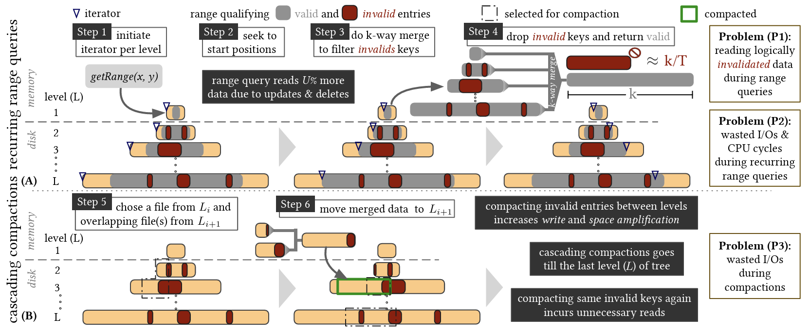
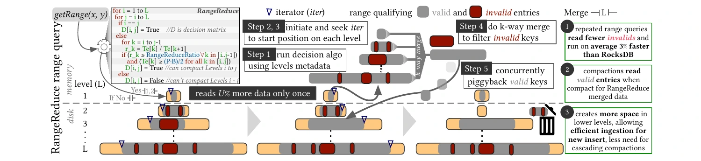
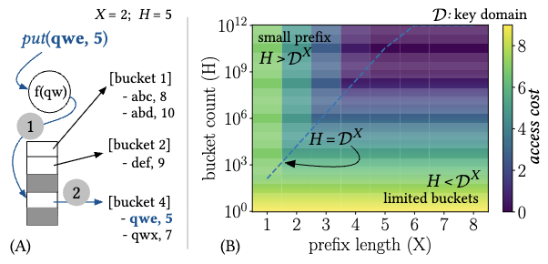

LSM-trees are built for writes. Every mutation is an append; reorganization is deferred to background compactions. The write path is almost free — the read path pays the bill. A point lookup must probe Bloom filters across multiple levels before touching disk. Range queries (RQs) are worse: every level may contribute sorted runs, each of which must be located, read, and *k*-way merged in memory before any result can be returned — a range query in a tiered tree with 5 levels and 10 runs per level performs a 50-way merge <a class="rp-cite" href="#pub-5">[5]</a>. And because updates and deletes are realized out of place, a significant share of what gets read and merged is *logically invalid* data. As an engineer at Google put it: "*in presence of deletes, range queries often have to process and skip millions of tombstones and logically deleted data*" <a class="rp-cite" href="#pub-5">[5]</a>.

The bitter irony is that the merge a range query performs is correct, complete — and thrown away. The next query over the same range starts from scratch, and background compaction later re-reads and re-merges the very same data. **RangeReduce** <a class="rp-cite" href="#pub-5">[5]</a>, our RQ-aware LSM engine built on RocksDB, breaks this cycle: it piggybacks on the reads a range query already performs and writes the merged, purged result back as a single sorted run — turning query execution itself into an engine optimization.

<blockquote class="rp-pull">
Every range scan already merges the relevant sorted runs in memory — the only question is whether to discard that work or capitalize on it.
</blockquote>

## The Problem: Excessive Reads and Repetitive Merging

<figure>
  
  <figcaption>The three problems RangeReduce attacks <a class="rp-cite" href="#pub-5">[5]</a>. (P1) A range query initializes an iterator per level, seeks, and k-way merges — reading logically invalidated entries alongside valid ones. (P2) Recurring and overlapping queries repeat the identical superfluous work. (P3) Compactions later re-read and rewrite the same invalid keys, cascading level by level toward the bottom of the tree.</figcaption>
</figure>

**Reading logically invalidated data.** In a leveled LSM-tree with size ratio 4, up to 25% of the entries can be logically invalid; every range query in an update- or delete-heavy workload parses this dead weight on every execution. The read amplification grows with the update fraction and the tree's size ratio — I/Os that fetch data the query will simply filter out <a class="rp-cite" href="#pub-5">[5]</a>.

**Wasted work for recurring and overlapping queries.** When identical or overlapping range queries repeat, both the random I/O cost of fetching the runs and the CPU cost of merging and filtering are paid separately for every query. Query-intensive workloads see rising latency and poor CPU utilization for work the engine has already done.

**Compaction debt.** LSM-trees accumulate *compaction debt* — the pending effort required to compact all intermediate data down to the last level. In a leveled tree with *L* levels and size ratio *T*, every entry is read and written *T·L* times on average during its lifetime; an entry qualifying for *C* recurring queries is processed *C + T·L* times in total. RQs and compactions thus multiply each other's waste — and in consumption-based cloud pricing, where users are billed for I/Os, storage, and CPU cycles, that waste is a line item <a class="rp-cite" href="#pub-5">[5]</a>.

These costs sit on top of a design space in which read behavior varies enormously: our design-space analysis shows a **60× gap** in point-lookup I/O cost between full tiering and full leveling, with the optimal Bloom filter memory allocation shifting with the read-write mix <a class="rp-cite" href="#pub-1">[1]</a> — trade-offs our SIGMOD and ICDE tutorials <a class="rp-cite" href="#pub-2">[2]</a><a class="rp-cite" href="#pub-3">[3]</a> make analytically precise through closed-form cost models.

## RangeReduce: Query-Driven Compactions

<figure>
  
  <figcaption>A range query in RangeReduce <a class="rp-cite" href="#pub-5">[5]</a>: a lightweight decision algorithm runs on level metadata (Step 1), iterators are positioned per level (Steps 2–3), and the k-way merge that filters invalid keys (Step 4) is concurrently written back as a compacted sorted run (Step 5) — repeated queries read fewer invalid entries, compactions reread only valid data, and shallower levels are freed for new ingestion.</figcaption>
</figure>

Naïvely compacting everything a query touches (*blind merge-on-scan*) backfires: it fragments levels into many small files and rewrites data to the same level with no forward progress, inflating writes by orders of magnitude for short queries. RangeReduce's contribution is making query-driven compaction *judicious*, through three co-designed mechanisms <a class="rp-cite" href="#pub-5">[5]</a>:

- **File-size-aware merging** skips levels whose qualifying data is too small to justify rewriting (less than half a file), and consolidates the non-qualifying remainders of terminal files into a single file — halving fragmentation while adding only ~4% to query cost.
- **Bounded-Merge** introduces the *RangeReduceRatio* (ρ), a single knob that triggers a merge between adjacent levels only when the deeper level holds at least ρ-proportionally more qualifying data — ensuring compactions make real forward progress. A large-scale empirical sweep of nine performance metrics shows ρ ≈ 1/T is robust across workloads, eliminating per-workload tuning.
- **Level-Renaming** absorbs tree growth without cascading compactions: when the last level fills, all levels are renamed one deeper (their capacities scale by T) and a fresh empty level opens at the top — performing T·L fewer cascading compactions each time the tree grows in height.

RangeReduce runs inside RocksDB's normal read and flush paths, keeps files immutable (unlike prior art that adds mutable metadata blocks), and can bound its own overhead against application SLOs — estimating a query's end-to-end latency from in-memory metadata and disabling query-driven compaction whenever the estimate would violate the target <a class="rp-cite" href="#pub-5">[5]</a>.

## The Read Path Begins in Memory: The LSM-Buffer Design Space

Before a query ever reaches disk, it consults the in-memory write buffer — and the buffer's data structure is a silently consequential design choice. Our first systematic benchmark of LSM memory buffers <a class="rp-cite" href="#pub-4">[4]</a> covers the four implementations used in production engines — vector, skip-list, hash skip-list, and hash linked-list — across ingestion, point-query, range-query, and flush/compaction behavior.

<figure>
  
  <figcaption>Hash-based buffers route each insert to a bucket by key prefix (A); their query performance hinges on tuning the prefix length X against the bucket count H (B) — mistuning either collapses the structure to a single overloaded bucket or explodes its memory footprint <a class="rp-cite" href="#pub-4">[4]</a>.</figcaption>
</figure>

The findings are stark. A vector buffer is the fastest structure for pure ingestion — up to **10×** faster than the alternatives — but the *slightest* read presence inverts the picture: shifting from insert-only to just **0.1% point queries** raises a vector buffer's mean operational latency by **36×**, because every query forces a sort-then-search over the unsorted buffer. Pre-allocating the vector's memory removes resizing spikes and improves tail performance by up to two orders of magnitude. Hash-structured buffers serve point queries fastest (3× faster than RocksDB's default skip-list when well-tuned) but pay for their pointer overhead with earlier saturation — roughly 50% more flushes and 70% more write volume downstream. No single buffer wins; the right choice follows from the workload, and the paper distills the sweep into a practitioner's selection guideline <a class="rp-cite" href="#pub-4">[4]</a>.

**Mind the Buffer** <a class="rp-cite" href="#pub-6">[6]</a> turns that benchmark into the first comprehensive map of the LSM-buffer design space. It evaluates eleven buffer implementations — the structures used in production engines (vectors, linked-lists, skip-lists and inline skip-lists, hash-based hybrids, B+-trees, and adaptive radix trees) alongside new designs such as a sorted vector, a scan-on-query vector, and a hash vector — in more than **1,200 experiments** that vary each buffer's tuning and size, the workload's composition and distribution, the LSM tuning, and the underlying hardware. The verdict sharpens the earlier one: as a workload shifts from insert-only to update-heavy, a hash linked-list outperforms a vector buffer by **24×**, while vector-based buffers lead by up to 1.7× in the insert-heavy phases. Tuning matters as much as the choice of structure — raising a hash-hybrid's bucket count from 1K to 100K speeds up ingestion by 6.8× for the hash skip-list and by three orders of magnitude for the hash linked-list <a class="rp-cite" href="#pub-6">[6]</a>.

Because the best buffer changes as the workload does, the paper also builds **Adapt**, a buffer that monitors the operation mix and switches its implementation on the fly without measurable overhead, and closes with a handbook of **ten guidelines** for choosing and tuning the buffer for a given workload and performance target <a class="rp-cite" href="#pub-6">[6]</a>.

## Key Results

  

    90%
    lower compaction debt than RocksDB (up to; 82% vs. SuccinctKV) <a class="rp-cite" href="#pub-5">[5]</a>
  

  

    20%
    lower space amplification, approaching the ideal LSM shape <a class="rp-cite" href="#pub-5">[5]</a>
  

  

    35%
    faster short range queries that overlap a prior long query <a class="rp-cite" href="#pub-5">[5]</a>
  

  

    36×
    buffer read-latency sensitivity to a 0.1% point-query fraction <a class="rp-cite" href="#pub-4">[4]</a>
  

  

    24×
    throughput swing between buffer designs when a workload turns update-heavy <a class="rp-cite" href="#pub-6">[6]</a>
  

Across uniform and overlapping workloads, RangeReduce reduces overall data movement by 12% and average range-query latency by up to 18% versus RocksDB, while improving ingestion throughput by up to 6% — and the benefits *grow* with scale: on an 8GB database, compaction debt drops by an order of magnitude and space amplification by ~95%, with mean query latency improving 23.3%. Projected onto AWS, GCP, and Azure consumption pricing with a 10TB dataset, RangeReduce cuts four-year storage-and-compaction expenditure by roughly **45%** versus RocksDB <a class="rp-cite" href="#pub-5">[5]</a>.

## Outlook

RangeReduce is, to our knowledge, the first system to use range queries as the trigger for opportunistic physical reorganization in LSM-trees — queries stop being pure consumers of engine state and become curators of it. The direction generalizes: any operation that reads data has, in principle, paid for the right to improve its layout. Extending query-driven reorganization to point-query batches, secondary attributes, and cost-model-driven scheduling against cloud pricing — where every avoided compaction is a measurable line item — is where this thread is headed.

## Relevant Publications

<ol class="rp-pubs">
  <li id="pub-1">Subhadeep Sarkar, Dimitris Staratzis, Zichen Zhu, Manos Athanassoulis. Constructing and Analyzing the LSM Compaction Design Space. PVLDB 2021.<a href="/assets/fulltext/Constructing_and_Analyzing_the_LSM_Compaction_Design_Space.pdf" target="_blank" rel="noopener" class="pub-icon" role="button" aria-label="PDF"><i class="fa-regular fa-file-pdf"></i></a><a href="/assets/resources/LSM_Compaction_VLDB.pdf" target="_blank" rel="noopener" class="pub-icon" role="button" aria-label="Slides"><i class="fa-solid fa-chalkboard"></i></a><a href="/assets/resources/PVLDB_poster.pdf" target="_blank" rel="noopener" class="pub-icon" role="button" aria-label="Poster"><i class="fa-regular fa-image"></i></a></li>
  <li id="pub-2">Subhadeep Sarkar, Manos Athanassoulis. Dissecting, Designing, and Optimizing LSM-based Data Stores. ACM SIGMOD Tutorial 2022.<a href="/assets/fulltext/Dissecting_Designing_and_Optimizing_LSM-based_Data_Stores.pdf" target="_blank" rel="noopener" class="pub-icon" role="button" aria-label="PDF"><i class="fa-regular fa-file-pdf"></i></a><a href="/assets/resources/SIGMOD_LSM_Tutorial.pdf" target="_blank" rel="noopener" class="pub-icon" role="button" aria-label="Slides"><i class="fa-solid fa-chalkboard"></i></a></li>
  <li id="pub-3">Subhadeep Sarkar, Niv Dayan, Manos Athanassoulis. The LSM Design Space and its Read Optimizations. ICDE Tutorial 2023.<a href="/assets/fulltext/The_LSM_Design_Space_and_its_Read_Optimizations.pdf" target="_blank" rel="noopener" class="pub-icon" role="button" aria-label="PDF"><i class="fa-regular fa-file-pdf"></i></a><a href="/assets/resources/ICDE_LSM_Tutorial.pdf" target="_blank" rel="noopener" class="pub-icon" role="button" aria-label="Slides"><i class="fa-solid fa-chalkboard"></i></a></li>
  <li id="pub-4">Shubham Kaushik, Subhadeep Sarkar. Anatomy of the LSM Memory Buffer: Insights &amp; Implications. DBTest @ ACM SIGMOD 2024.<a href="/assets/fulltext/Anatomy_of_the_LSM_Memory_Buffer_Insights_&_Implications.pdf" target="_blank" rel="noopener" class="pub-icon" role="button" aria-label="PDF"><i class="fa-regular fa-file-pdf"></i></a><a href="/assets/resources/LSMMemoryBuffer_TPCTC.pdf" target="_blank" rel="noopener" class="pub-icon" role="button" aria-label="Slides"><i class="fa-solid fa-chalkboard"></i></a><a href="https://github.com/SSD-Brandeis/LSMMemoryProfiling" target="_blank" rel="noopener" class="pub-icon" role="button" aria-label="Code"><i class="fa-brands fa-github"></i></a></li>
  <li id="pub-5">Shubham Kaushik, Manos Athanassoulis, Subhadeep Sarkar. RangeReduce: Query-Driven LSM Compactions. ICDE 2026.<a href="/assets/fulltext/RangeReduce_Query-Driven_LSM_Compactions.pdf" target="_blank" rel="noopener" class="pub-icon" role="button" aria-label="PDF"><i class="fa-regular fa-file-pdf"></i></a><a href="/assets/resources/RangeReduce_ICDE.pdf" target="_blank" rel="noopener" class="pub-icon" role="button" aria-label="Slides"><i class="fa-solid fa-chalkboard"></i></a><a href="/assets/resources/RangeReduce.pdf" target="_blank" rel="noopener" class="pub-icon" role="button" aria-label="Poster"><i class="fa-regular fa-image"></i></a><a href="https://github.com/SSD-Brandeis/RangeReduce" target="_blank" rel="noopener" class="pub-icon" role="button" aria-label="Code"><i class="fa-brands fa-github"></i></a></li>
  <li id="pub-6">Boao Chen, Shubham Kaushik, Subhadeep Sarkar. Mind the Buffer: Dissecting the LSM-Buffer Design Space. VLDB 2027.<a href="/assets/fulltext/Mind_the_Buffer_Dissecting_the_LSM-Buffer_Design_Space.pdf" target="_blank" rel="noopener" class="pub-icon" role="button" aria-label="PDF"><i class="fa-regular fa-file-pdf"></i></a><a href="https://github.com/SSD-Brandeis/LSMMemoryProfiling" target="_blank" rel="noopener" class="pub-icon" role="button" aria-label="Code"><i class="fa-brands fa-github"></i></a></li>
</ol>
