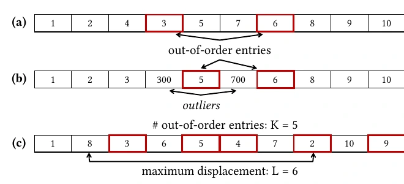
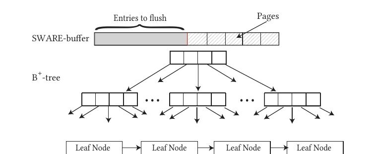

Real-world data is almost never uniformly random. Time-series aggregates, log-based server data, event-based sensor streams, and even stock tickers arrive *close to* sorted on their natural key; in TPC-H's `lineitem` table, ordering the data on `shipdate` leaves `commitdate` and `receiptdate` nearly sorted as well <a class="rp-cite" href="#pub-1">[1]</a><a class="rp-cite" href="#pub-3">[3]</a>. Yet classical index designs are built for the two *extremes* of sortedness — scrambled data (regular insertion) and fully sorted data (bulk loading) — and pay the same construction cost for everything in between, as if every key were adversarial. Since indexing is precisely the act of adding order to incoming data, *the indexing effort should be minimal when the data arrives with some intrinsic order*.

Our research treats **sortedness as a first-class resource**: something that can be measured, benchmarked, and exploited to dramatically accelerate ingestion without compromising query performance. The thread runs from **BoDS** <a class="rp-cite" href="#pub-4">[4]</a>, the first benchmark to expose sortedness as a controlled experimental axis, through **SWARE** <a class="rp-cite" href="#pub-3">[3]</a>, a design paradigm that retrofits any tree index with sortedness-awareness, to **QuIT** <a class="rp-cite" href="#pub-1">[1]</a>, which distills the idea to a nearly zero-overhead design.

<blockquote class="rp-pull">
Can we design indexes that learn from the order in which data arrives — and exploit partial sortedness without sacrificing lookups when data is not sorted?
</blockquote>

## Measuring Order: The (K, L)-Sortedness Metric

Exploiting sortedness first requires quantifying it. We adopt the **(K, L)-sortedness metric** of Ben-Moshe et al., which captures disorder along two independent dimensions: *K*, the number of entries that are out of order, and *L*, the maximum displacement of an out-of-order entry from its sorted position <a class="rp-cite" href="#pub-1">[1]</a><a class="rp-cite" href="#pub-4">[4]</a>. Unlike simpler measures (inversions, runs, exchanges), (K, L) distinguishes *how many* entries are misplaced from *how far* they strayed — a collection with few but distant outliers behaves very differently from one with many small local swaps.

<figure>
  
  <figcaption>Out-of-order entries (a), outliers that deviate greatly in magnitude (b), and the (K, L) metric in action (c): five entries are out of order (K = 5) and the farthest is displaced by six positions (L = 6) <a class="rp-cite" href="#pub-1">[1]</a>.</figcaption>
</figure>

**BoDS** <a class="rp-cite" href="#pub-4">[4]</a> builds a benchmark around this metric: a variable-sortedness data generator (with a user-specified distribution for *L*) and five workload types — pure bulk loading, one-by-one insertion, and mixed read/write workloads with and without preloading. Running BoDS on PostgreSQL confirms the motivating suspicion: a production-grade relational system *cannot exploit intermediate sortedness* — ingestion cost stays essentially flat as data approaches sorted order — quantifying the headroom that sortedness-aware designs can claim.

## SWARE: A Paradigm for Sortedness-Aware Indexes

**SWARE** <a class="rp-cite" href="#pub-3">[3]</a> is not a new index but a *meta-design*: a framework that converts any tree index into its sortedness-aware counterpart. It combines four design elements: (i) *fast-path insertion* that sidesteps the root-to-leaf traversal for in-order entries; (ii) *opportunistic bulk loading* that ingests sorted runs at bulk-load speed; (iii) *variable fill and split factors* — splitting nodes 80:20 rather than 50:50 when data trends sorted, which packs nodes fuller and avoids the pathological half-empty nodes a B⁺-tree produces under sorted insertion; and (iv) an *intelligent buffer* that captures near-sortedness before it reaches the tree.

<figure>
  
  <figcaption>The sortedness-aware B⁺-tree <a class="rp-cite" href="#pub-3">[3]</a>: an in-memory SWARE-buffer intercepts all inserts, keeps a sorted prefix (tracked by a last-sorted-zone marker), and flushes opportunistically — bulk-loading the sorted fraction into the tree and top-inserting only the overlapping remainder.</figcaption>
</figure>

The buffer is where the subtlety lives. Flushing is *partial and opportunistic*: only the sorted, non-overlapping fraction of the buffer is bulk-loaded, so sorting work is never wasted. Because every query must now also check the buffer, SWARE keeps that overhead nominal with a layered read path — Zonemaps to identify overlapping pages, a global Bloom filter plus per-page Bloom filters to skip the unsorted section, interpolation search over the sorted section, and *query-driven partial sorting* (inspired by database cracking) that lets queries progressively add structure to the buffer <a class="rp-cite" href="#pub-3">[3]</a>.

Applied to a B⁺-tree and a Bε-tree, SWARE delivers up to **8.8×** and **7.8×** faster ingestion, respectively, for write-heavy workloads on near-sorted data, with overall benefits of **1.3–5×** for mixed read/write workloads and up to **48%** better space utilization <a class="rp-cite" href="#pub-3">[3]</a>.

## QuIT: Sortedness-Awareness at Near-Zero Overhead

SWARE buys its gains with a buffer, auxiliary filter structures, and tuning — and its point queries can run up to 26% slower than the baseline. **QuIT** (Quick Insertion Tree) <a class="rp-cite" href="#pub-1">[1]</a> asks how much of the benefit survives if nearly all of that machinery is removed. The answer: most of it — and then some.

QuIT's key ingredient is the ***predicted-ordered-leaf* (poℓe)**: a single in-memory pointer to the leaf where the next in-order key is *predicted* to land. Its precursor, the *last-insertion-leaf* (ℓiℓ), already improves on the tail-leaf fast-path used in production systems (e.g., PostgreSQL), which collapses to almost no fast-inserts with just 1% out-of-order entries; ℓiℓ sustains 98% fast-inserts at that disorder level. poℓe goes further: on a node split it *predicts* which of the two resulting nodes future in-order entries will target, keeping the fast-path fresh instead of stale. When the prediction misses, QuIT simply falls back to a standard root-to-leaf insert — so on scrambled data it is exactly a B⁺-tree, and *its benefits come with no read penalty*. The required metadata is one pointer and a handful of boundary keys.

QuIT also adapts its split policy through the **In-order Key estimatoR (IKR)**, inspired by the inter-quartile range: when incoming data trends sorted, splits leave more room in the predicted-hot node and redistribute entries to under-utilized neighbors, packing leaves tighter. The result is an index that ingests up to **2.3× faster than a tail-leaf-optimized B⁺-tree** and up to **2× faster than SWARE** on near-sorted data, serves point lookups up to **1.32× faster than SWARE**, improves memory utilization by up to **49%** over a B⁺-tree, and touches up to **2× fewer leaf nodes** during range queries thanks to denser packing <a class="rp-cite" href="#pub-1">[1]</a> — all with essentially no tuning and no added read cost.

## Key Results

  

    8.8×
    faster ingestion for the sortedness-aware B⁺-tree on near-sorted data (SWARE) <a class="rp-cite" href="#pub-3">[3]</a>
  

  

    2.3×
    faster ingestion than a tail-leaf B⁺-tree — with zero read penalty (QuIT) <a class="rp-cite" href="#pub-1">[1]</a>
  

  

    98%
    fast-inserts sustained at 1% disorder, where the production tail-leaf fast-path collapses <a class="rp-cite" href="#pub-1">[1]</a>
  

  

    49%
    better memory utilization than a B⁺-tree via prediction-driven splits (QuIT) <a class="rp-cite" href="#pub-1">[1]</a>
  

## Outlook

The arc of this project — benchmark, paradigm, minimal design — argues that sortedness belongs alongside selectivity and skew as a standard axis of index design. The BoDS results show production systems leave this performance on the table today; SWARE shows how much can be claimed with a full framework; QuIT shows the price of admission can be a single pointer. The natural next steps run in both directions: pushing sortedness-awareness into LSM ingestion paths and production storage engines, and generating controlled near-sorted workloads at scale — which our Tectonic benchmark generator <a class="rp-cite" href="#pub-2">[2]</a> already supports — so that any index can be evaluated honestly on the data it will actually see.

## Relevant Publications

<ol class="rp-pubs">
  <li id="pub-1">Aneesh Raman, Konstantinos Karatsenidis, Shaolin Xie, Matthaios Olma, Subhadeep Sarkar, Manos Athanassoulis. QuIT your B+-tree for the Quick Insertion Tree. EDBT 2025.<a href="/assets/fulltext/QuIT_your_B+_tree_for_the_Quick_Insertion_Tree.pdf" target="_blank" rel="noopener" class="pub-icon" role="button" aria-label="PDF"><i class="fa-regular fa-file-pdf"></i></a><a href="/assets/resources/QuiT_EDBT.pdf" target="_blank" rel="noopener" class="pub-icon" role="button" aria-label="Slides"><i class="fa-solid fa-chalkboard"></i></a><a href="https://github.com/BU-DiSC/quick-insertion-tree" target="_blank" rel="noopener" class="pub-icon" role="button" aria-label="Code"><i class="fa-brands fa-github"></i></a></li>
  <li id="pub-2">Alexander H. Ott, Shubham Kaushik, Boao Chen, Subhadeep Sarkar. Tectonic: Bridging Synthetic and Real-World Workloads for Key-Value Benchmarking. TPCTC 2025.<a href="/assets/fulltext/Tectonic_Bridging_Synthetic_and_Real-World_Workloads_for_Key-Value_Benchmarking.pdf" target="_blank" rel="noopener" class="pub-icon" role="button" aria-label="PDF"><i class="fa-regular fa-file-pdf"></i></a><a href="/assets/resources/Tectonic_TPCTC.pdf" target="_blank" rel="noopener" class="pub-icon" role="button" aria-label="Slides"><i class="fa-solid fa-chalkboard"></i></a><a href="https://github.com/SSD-Brandeis/tectonic" target="_blank" rel="noopener" class="pub-icon" role="button" aria-label="Code"><i class="fa-brands fa-github"></i></a></li>
  <li id="pub-3">Aneesh Raman, Subhadeep Sarkar, Matthaios Olma, Manos Athanassoulis. Indexing for Near-Sorted Data. ICDE 2023.<a href="/assets/fulltext/Indexing_for_Near-Sorted_Data.pdf" target="_blank" rel="noopener" class="pub-icon" role="button" aria-label="PDF"><i class="fa-regular fa-file-pdf"></i></a><a href="/assets/resources/Sware_ICDE.pdf" target="_blank" rel="noopener" class="pub-icon" role="button" aria-label="Slides"><i class="fa-solid fa-chalkboard"></i></a><a href="/assets/resources/SWARE_ICDE_poster.pdf" target="_blank" rel="noopener" class="pub-icon" role="button" aria-label="Poster"><i class="fa-regular fa-image"></i></a><a href="https://github.com/BU-DiSC/sware" target="_blank" rel="noopener" class="pub-icon" role="button" aria-label="Code"><i class="fa-brands fa-github"></i></a></li>
  <li id="pub-4">Aneesh Raman, Konstantinos Karatsenidis, Subhadeep Sarkar, Matthaios Olma, Manos Athanassoulis. BoDS: A Benchmark on Data Sortedness. TPCTC 2022.<a href="/assets/fulltext/BODS_A_Benchmark_on_Data_Sortedness.pdf" target="_blank" rel="noopener" class="pub-icon" role="button" aria-label="PDF"><i class="fa-regular fa-file-pdf"></i></a><a href="https://github.com/BU-DiSC/bods" target="_blank" rel="noopener" class="pub-icon" role="button" aria-label="Code"><i class="fa-brands fa-github"></i></a></li>
</ol>
